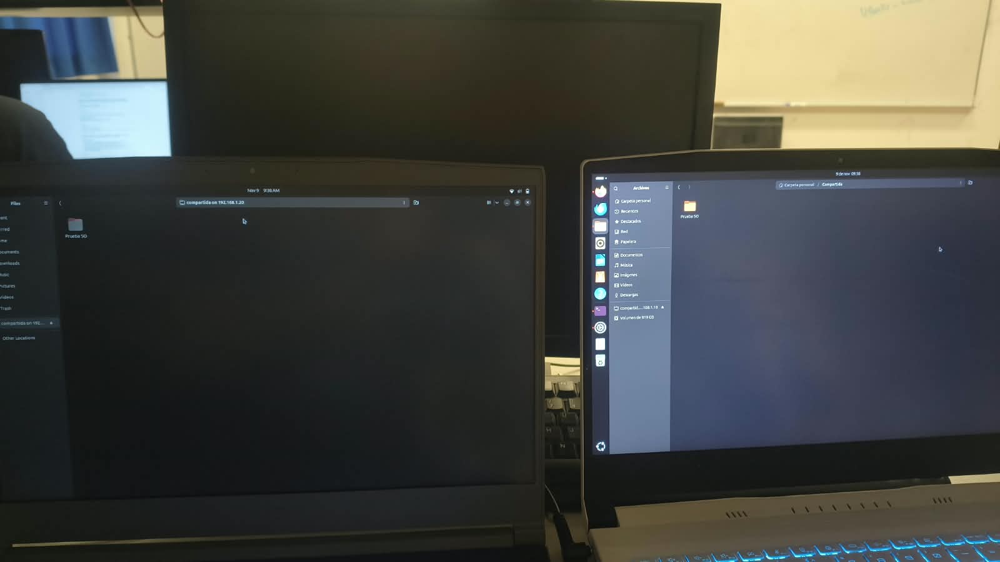
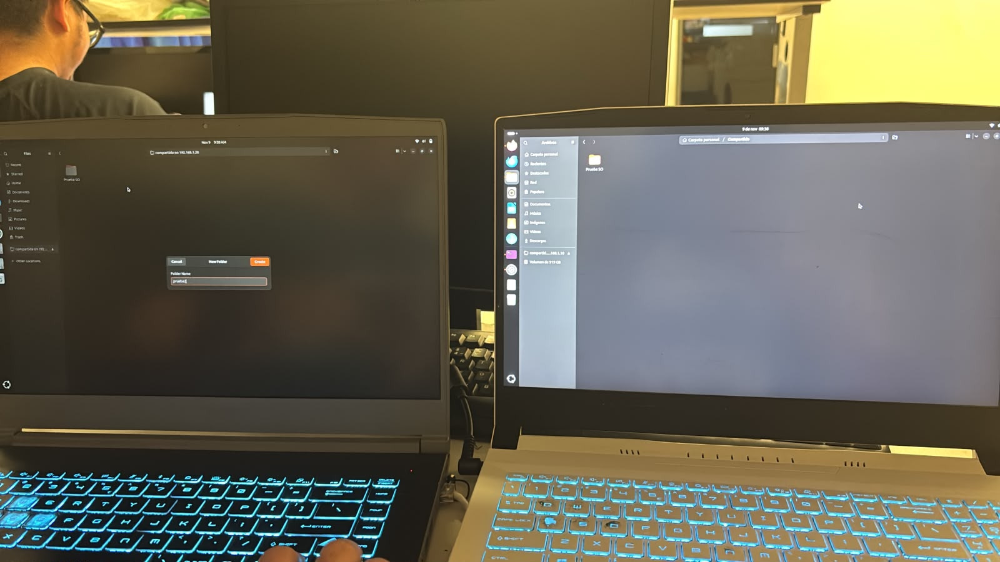
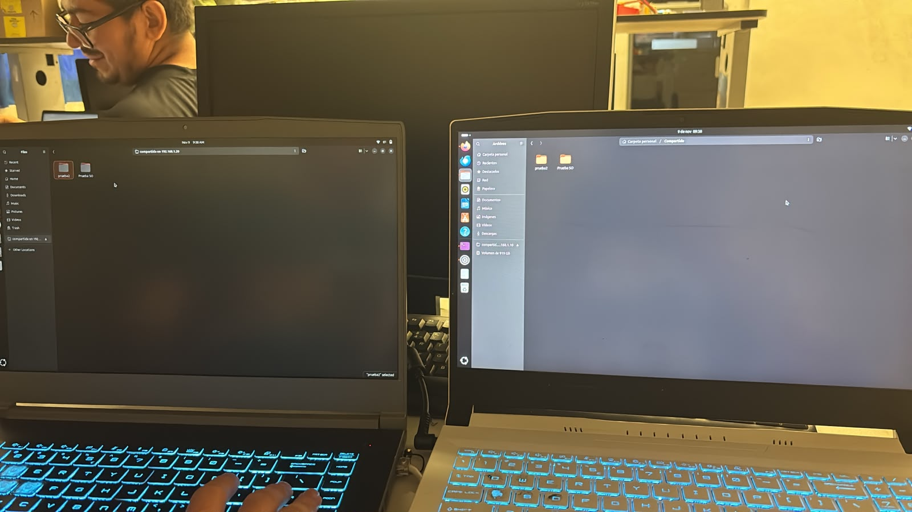

# Carpeta compartida entre dos equipos Ubuntu con Samba

## Descripción

Esta práctica consiste en compartir una carpeta entre dos computadoras con Ubuntu conectadas a la misma red local, utilizando Samba. Samba es el servicio que permite compartir archivos en red mediante el protocolo SMB, el mismo que usa Windows para sus carpetas compartidas.

Uno de los equipos funciona como servidor: tiene la carpeta `Compartida` dentro de su carpeta personal y la comparte en la red. El otro equipo funciona como cliente: se conecta a ella desde el gestor de archivos escribiendo la dirección `smb://192.168.1.20/compartida`. Para esta práctica no se utilizó un usuario de Samba; la carpeta se compartió con acceso de invitado.

Para comprobar el funcionamiento, desde el equipo cliente se creó una carpeta nueva dentro de la carpeta compartida y se verificó que apareciera también en el equipo servidor.

## Objetivos de aprendizaje

* Asignar direcciones IP manuales a dos equipos para que se comuniquen en la misma red.
* Instalar el servicio Samba en Ubuntu.
* Compartir una carpeta en la red local desde el gestor de archivos.
* Conectarse a una carpeta compartida desde otro equipo Ubuntu.
* Comprobar que los cambios hechos desde un equipo se reflejan en el otro.

## Material utilizado

* Dos equipos con Ubuntu
* Cable de red / red local
* Samba (`samba`)
* Terminal de Ubuntu
* Gestor de archivos de Ubuntu (Nautilus)

## Configuración de la red

Las direcciones se asignaron de forma manual en **Configuración > Red > Cableada > IPv4 > Manual**.

| Equipo | Función | Dirección IP |
|---|---|---|
| Ubuntu 1 | Servidor (tiene la carpeta `Compartida`) | `192.168.1.20` |
| Ubuntu 2 | Cliente (se conecta a la carpeta) | `192.168.1.10` |

Ambos equipos usan la máscara `255.255.255.0` (`/24`), por lo que pertenecen a la misma red `192.168.1.0/24`.

## Pasos realizados

```bash
# Instalar Samba (en el servidor)
sudo apt update
sudo apt install samba

# Crear la carpeta que se va a compartir
mkdir ~/Compartida

# Comprobar la dirección IP de cada equipo
ip a

# Comprobar la comunicación entre los equipos (desde el cliente)
ping 192.168.1.20
```

En el servidor se compartió la carpeta desde el gestor de archivos: clic derecho en `Compartida` > **Compartir en la red local**, activando **Compartir esta carpeta**, **Permitir a otras personas crear y eliminar archivos** y **Acceso de invitado**.

En el equipo cliente se abrió el gestor de archivos, se eligió **Otras ubicaciones** y en **Conectar al servidor** se escribió:

```
smb://192.168.1.20/compartida
```

## Código

[Ver carpeta de código](Codigo)

* [Pasos y comandos de la práctica](Codigo/configuracion_samba.txt)

## Evidencias

[Ver carpeta de evidencias](Terminal)

### Carpeta compartida antes de crear el archivo

Del lado izquierdo, el equipo cliente conectado a `compartida on 192.168.1.20`; del lado derecho, el equipo servidor con su carpeta `Compartida`. En ambos solo aparece la carpeta `Prueba SO`. En la barra lateral del servidor también se ve `compartida on 192.168.1.10`, porque la conexión se hizo en los dos sentidos; la prueba documentada es la del cliente hacia el servidor `192.168.1.20`.



### Creación de una carpeta desde el equipo cliente

Desde el equipo cliente se crea la carpeta `prueba2` dentro de la carpeta compartida. El equipo servidor todavía no la muestra.



### Carpeta visible en los dos equipos

Después de crearla, la carpeta `prueba2` aparece tanto en el cliente como en el servidor.



## Reporte

El reporte formal de la práctica se encuentra en:

[Ver reporte](Reporte)

[Ver Reporte.pdf](Reporte/Reporte.pdf)

## Video

En la siguiente carpeta se encuentra el video de demostración de la práctica:

[Ver carpeta de video](Video)

[Ver video de la práctica](https://youtu.be/KG_IWCfnLlw)

## Conclusión

La práctica permitió comprobar que dos equipos con Ubuntu pueden compartir archivos dentro de una red local por medio de Samba. Basta con que ambos equipos estén en la misma red, que Samba esté instalado y que la carpeta se comparta con permiso para crear y eliminar archivos.

Al crear una carpeta desde el equipo cliente, esta apareció también en el servidor, lo que demuestra que los dos equipos trabajan sobre la misma carpeta y no sobre copias separadas.
