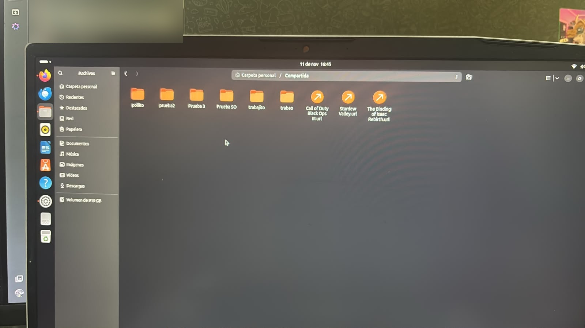
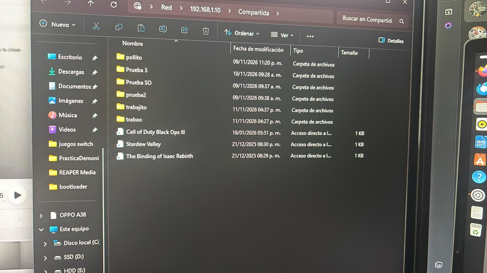
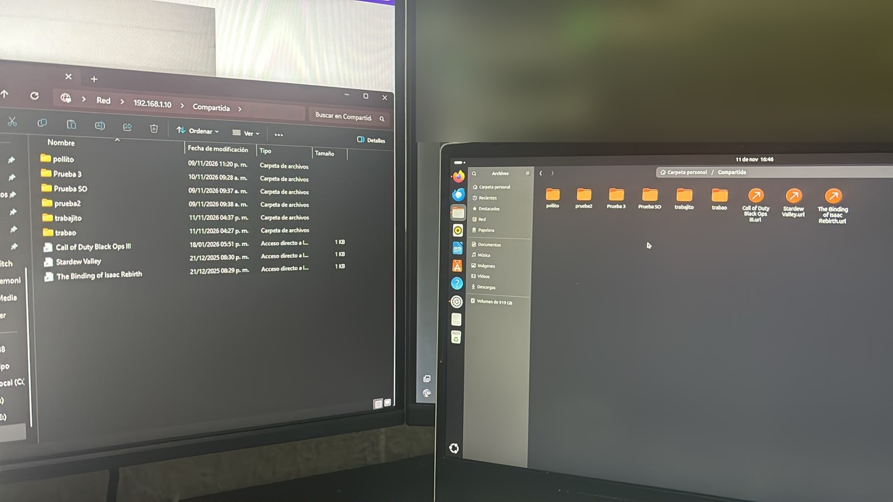

# Carpeta compartida entre Ubuntu y Windows con Samba

## Descripción

Esta práctica consiste en compartir una carpeta entre un equipo con Ubuntu y otro con Windows conectados a la misma red local, utilizando Samba. Samba implementa en Linux el protocolo SMB, que es el que usa Windows para compartir carpetas, por lo que Windows puede abrir la carpeta de Ubuntu sin instalar ningún programa adicional.

El equipo con Ubuntu funciona como servidor: tiene la carpeta `Compartida` y la comparte en la red. Desde Windows se abrió con **Windows + R** escribiendo la ruta `\\192.168.1.10\Compartida` e ingresando el usuario de Samba `tilininsano`.

Para comprobar el funcionamiento, desde Windows se agregaron archivos y carpetas dentro de la carpeta compartida y se verificó que aparecieran también en Ubuntu.

## Objetivos de aprendizaje

* Asignar direcciones IP manuales a un equipo Ubuntu y a uno Windows en la misma red.
* Instalar el servicio Samba en Ubuntu.
* Compartir una carpeta de Ubuntu en la red local.
* Crear un usuario de Samba para el acceso desde Windows.
* Abrir una carpeta de Linux desde Windows mediante su ruta de red.
* Comprobar que los cambios hechos desde un sistema se reflejan en el otro.

## Material utilizado

* Equipo con Ubuntu
* Equipo con Windows
* Cable de red / red local
* Samba (`samba`)
* Terminal de Ubuntu
* Explorador de archivos de Windows

## Configuración de la red

Las direcciones se asignaron de forma manual en ambos equipos.

| Equipo | Sistema | Función | Dirección IP |
|---|---|---|---|
| Servidor | Ubuntu | Tiene la carpeta `Compartida` | `192.168.1.10` |
| Cliente | Windows | Se conecta a la carpeta | `192.168.1.20` |

Ambos equipos usan la máscara `255.255.255.0` (`/24`).

* **Ubuntu:** Configuración > Red > Cableada > IPv4 > Manual
* **Windows:** Configuración > Red e Internet > Ethernet > Asignación de IP > Editar > Manual

## Pasos realizados

### En Ubuntu

```bash
# Instalar Samba
sudo apt update
sudo apt install samba

# Crear la carpeta que se va a compartir
mkdir ~/Compartida

# Crear el usuario de Samba (Windows pide usuario y contraseña)
sudo smbpasswd -a tilininsano

# Comprobar la dirección IP
ip a
```

La carpeta se compartió desde el gestor de archivos: clic derecho en `Compartida` > **Compartir en la red local**, activando **Compartir esta carpeta** y **Permitir a otras personas crear y eliminar archivos**.

### En Windows

```powershell
# Comprobar la dirección IP
ipconfig

# Comprobar la comunicación con Ubuntu
ping 192.168.1.10
```

Con **Windows + R** se escribió la ruta:

```
\\192.168.1.10\Compartida
```

y se ingresaron el usuario `tilininsano` y su contraseña. La carpeta de Ubuntu se abrió en el Explorador de archivos de Windows.

## Código

[Ver carpeta de código](Codigo)

* [Pasos y comandos de la práctica](Codigo/configuracion_samba.txt)

## Evidencias

[Ver carpeta de evidencias](Terminal)

### Carpeta compartida en Ubuntu

Carpeta `Compartida` en el equipo con Ubuntu (servidor), con las carpetas y archivos de prueba.



### Carpeta abierta desde Windows

Desde Windows se abrió la ruta `\\192.168.1.10\Compartida` en el Explorador de archivos y se ven los mismos archivos que en Ubuntu.



### Los dos equipos al mismo tiempo

Windows (izquierda) y Ubuntu (derecha) muestran el mismo contenido de la carpeta compartida, incluidas las carpetas `trabajito` y `trabao` agregadas durante la práctica.



## Reporte

El reporte formal de la práctica se encuentra en:

[Ver reporte](Reporte)

[Ver Reporte.pdf](Reporte/Reporte.pdf)

## Video

En la siguiente carpeta se encuentra el video de demostración de la práctica:

[Ver carpeta de video](Video)

[Ver video de la práctica](https://youtu.be/owNGFM9QuzQ)

## Conclusión

La práctica permitió comprobar que Ubuntu y Windows pueden compartir archivos dentro de una red local por medio de Samba, ya que ambos utilizan el protocolo SMB. Windows no necesita programas adicionales: basta con escribir la ruta de red del equipo Ubuntu en Windows + R e ingresar un usuario de Samba.

Los archivos agregados desde Windows aparecieron también en la carpeta de Ubuntu, lo que demuestra que los dos sistemas trabajan sobre la misma carpeta.
